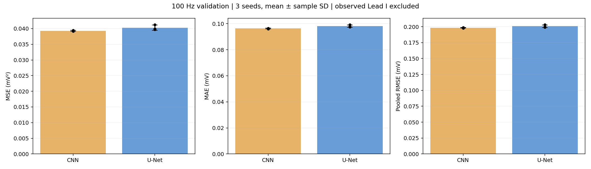
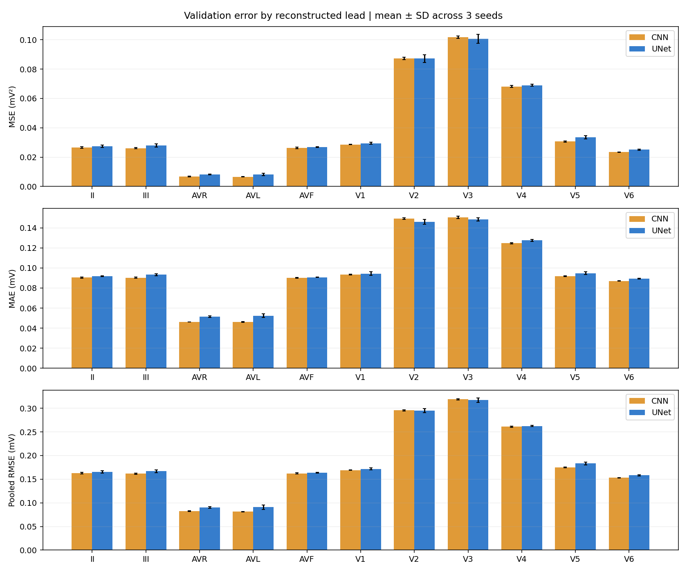
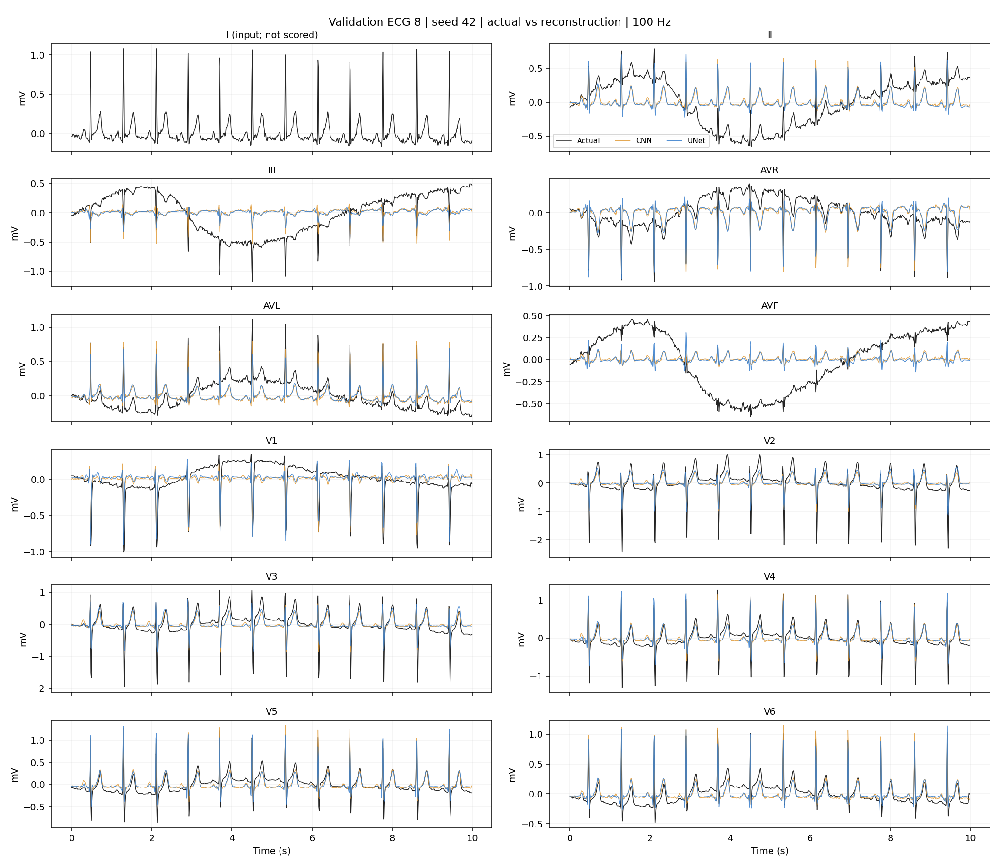

# 3번 100Hz U-Net 실험 결과

실제 데이터로 CPU 학습과 검증 평가를 완료했습니다. seed 42/43/44에서 각각 30 epoch를 수행했습니다. 동일 조건에서 U-Net의 평균 MSE, MAE, pooled RMSE 모두 기존 CNN보다 높았습니다. U-Net 구현은 완료했으나 성능 개선에 성공했다고 보고하지 않습니다.

## 전체 결과: 검증 100개, 예측 11유도

| 모델 | MSE (mV²) | MAE (mV) | pooled RMSE (mV) |
| --- | --- | --- | --- |
| CNN | 0.039281 ± 0.000151 | 0.096338 ± 0.000264 | 0.198193 ± 0.000382 |
| UNet | 0.040291 ± 0.000830 | 0.098139 ± 0.000939 | 0.200720 ± 0.002062 |

CNN 대비 오차 증가: MSE 2.57%, MAE 1.87%, RMSE 1.27%. ±는 seed 3개의 표본 표준편차입니다. RMSE는 seed별 pooled RMSE를 구한 뒤 평균했습니다.

## Seed별 결과

| 모델 | seed | 선택 epoch | MSE | MAE | pooled RMSE |
| --- | --- | --- | --- | --- | --- |
| CNN | 42 | 16 | 0.039456 | 0.096458 | 0.198634 |
| CNN | 43 | 22 | 0.039195 | 0.096035 | 0.197978 |
| CNN | 44 | 24 | 0.039191 | 0.096521 | 0.197967 |
| UNet | 42 | 20 | 0.039726 | 0.097499 | 0.199313 |
| UNet | 43 | 30 | 0.041244 | 0.099217 | 0.203087 |
| UNet | 44 | 19 | 0.039904 | 0.097701 | 0.199760 |

## 유도별 결과

양수 개선율은 U-Net 오차 감소, 음수는 증가입니다. 3 seed 평균입니다.

| 유도 | CNN MSE | U-Net MSE | MSE 개선율 | CNN MAE | U-Net MAE |
| --- | --- | --- | --- | --- | --- |
| II | 0.026463 | 0.027366 | -3.42% | 0.090451 | 0.091638 |
| III | 0.026121 | 0.027896 | -6.80% | 0.090325 | 0.093285 |
| AVR | 0.006802 | 0.008144 | -19.73% | 0.046098 | 0.051465 |
| AVL | 0.006617 | 0.008276 | -25.07% | 0.046161 | 0.052447 |
| AVF | 0.026324 | 0.026751 | -1.62% | 0.090240 | 0.090701 |
| V1 | 0.028562 | 0.029473 | -3.19% | 0.093398 | 0.094352 |
| V2 | 0.087301 | 0.087144 | +0.18% | 0.149269 | 0.145930 |
| V3 | 0.101713 | 0.100692 | +1.00% | 0.150411 | 0.148313 |
| V4 | 0.068164 | 0.068887 | -1.06% | 0.124630 | 0.127396 |
| V5 | 0.030628 | 0.033545 | -9.52% | 0.091751 | 0.094774 |
| V6 | 0.023393 | 0.025031 | -7.00% | 0.086986 | 0.089230 |

V2·V3에서는 평균 MSE가 소폭 감소했지만 나머지 9개 유도에서는 증가했습니다. 기록별로 seed 평균 MSE를 비교하면 30/100개에서 감소했습니다. 이는 통계적 유의성 검정 결과가 아닙니다. 유도별 RMSE와 전체 정밀 수치는 results/comparison/comparison_by_lead.csv에 있습니다.

## 실제 파형 비교

성능을 보고 사례를 선택하지 않았습니다. 검증 데이터의 가장 작은 ECG ID 8·10·17을 사전에 정한 규칙으로 선택하고 seed 42의 각 모델 최저 검증 MSE 가중치를 사용했습니다. 관측 I은 입력으로만 표시하며 점수에 포함하지 않습니다. 검은색=실제, 주황색=CNN, 파란색=U-Net입니다.

다른 두 사례 및 학습곡선, 기록별 MSE 산점도는 results/comparison/figures/에 있습니다.

## 공정성 및 재현 확인

- GitHub 최신 main 92872ee의 2번 결과를 기준으로 사용했습니다.
- 학습 798 / 검증 100 / 테스트 100, 동일 ECG와 환자 분할, 동일 mV 원신호 및 전처리 없음 조건입니다.
- 같은 seed, 30 epoch, batch 8, Adam 0.001, MSE, 최저 validation MSE 선택을 사용했습니다.
- 기존 CNN을 동일 환경에서 원본 코드 그대로 재학습했습니다. 3개 seed 모두 기존 예측과 학습 이력의 최대 절대 차이는 0이었습니다.
- 데이터와 라벨 및 CNN 코드 해시를 검증했습니다. 공개된 실제 파형 전용 NPZ 해시를 사용했습니다.
- 모든 비교 지표를 저장된 실제 파형/예측에서 float64로 독립 재계산하여 저장 표와 대조했습니다.
- 모델 출력 shape, 유한한 gradient, 잘못된 입력 길이 차단 및 알려진 값의 지표 계산 검사를 통과했습니다.

## 해석과 한계

이번 결과는 동일 학습 예산에서의 구조 비교입니다. CNN 31,819개와 U-Net 5,237,067개로 파라미터 수는 다릅니다. 학습시간도 같게 맞춘 실험이 아닙니다. 일부 CPU 작업은 동시에 수행했으므로 기록된 실행시간은 모델 속도 벤치마크로 사용하지 마세요.

논문 공개 코드의 6단계 U-Net을 바탕으로 100Hz kernel=5, 출력 11개, linear 출력으로 변경했습니다. 논문의 정상군·학습률·학습량을 그대로 재현한 실험이 아닙니다. 특히 CNN과 맞춘 lr=0.001과 30 epoch가 U-Net에 최적인지는 확인하지 않았습니다. 성능 악화의 원인을 단정할 수 없으며, 결과를 보고 임의로 설정을 바꾼 추가 실험은 하지 않았습니다. 세부 구분은 docs/PAPER_AND_ADAPTATION.md를 참고하세요.

모델 선택에 사용한 검증 데이터 결과이므로 최종 일반화 성능이 아닙니다. 테스트 100개는 추론하지 않았습니다. 500Hz 데이터 처리·학습·평가·주파수 비교 및 다른 팀원 코드 수정은 하지 않았습니다. 향후 최종 테스트를 할 경우 두 모델을 같은 테스트 데이터에서 한 번에 평가해야 합니다.

## 전달용 요약

100Hz 기준으로 논문 공개 코드 기반 U-Net 구현 및 3개 seed 학습·검증을 완료했습니다. 기존 CNN과 데이터, 환자 분할, 전처리, 학습 조건을 맞췄으며 전체 MSE는 CNN 0.039281, U-Net 0.040291로 U-Net이 약 2.57% 높았습니다. V2·V3는 소폭 개선되었지만 전체 성능 개선은 확인하지 못했습니다. 코드, 가중치, 예측, 결과표와 비교 파형을 함께 정리했습니다.
