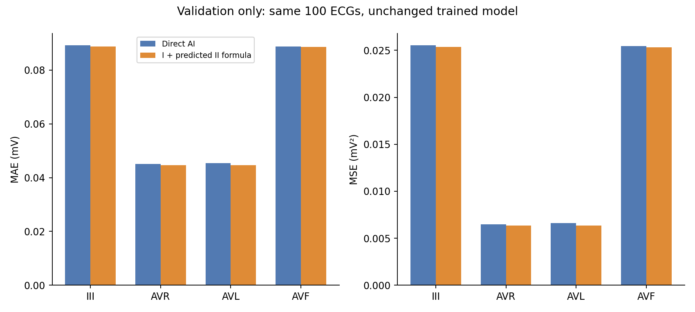
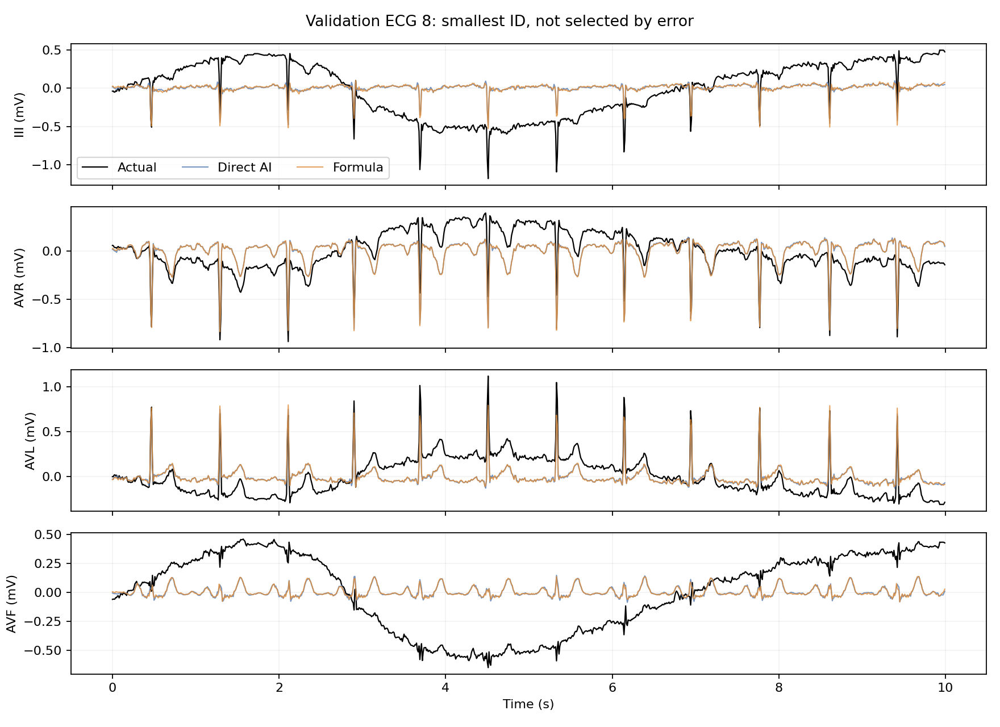

# 실제 I + 예측 II 공식 적용 비교 / NORM 혼합 라벨 검토

작성일: 2026-11-01

## 이번에 한 일

기존 Dilated seed 42, epoch 28의 재구성 NPZ를 사용했다. 새 학습 없이 실제 Lead I과 기존 AI 예측 Lead II로 III·aVR·aVL·aVF만 다시 계산했다. II와 V1~V6는 기존 예측을 유지했다. **검증 ECG 100개만 파형 오차를 계산했고 테스트 파형 오차는 계산하지 않았다.** 기존 데이터·가중치·라벨·분류 결과를 변경하지 않았다.

## 적용 공식

- III = II − I
- aVR = −(I + II) / 2
- aVL = I − II / 2
- aVF = II − I / 2

이번 실험의 I는 실제 관측값, II는 AI 예측값이다. 실제 정답 II를 사용해 성능을 높이는 방식이 아니다. 실제 II는 별도의 원본 관계식 잔차 확인에만 사용했다. V1~V6는 이 공식으로 구할 수 없다.

공식 근거: AHA/ACCF/HRS ECG 표준화 권고의 사지유도 정의.
https://www.ahajournals.org/doi/10.1161/CIRCULATIONAHA.106.180200

## 검증 결과

낮을수록 좋은 파형 오차다. MSE 감소율은 `(기존−공식)/기존×100`으로 계산했다.

| 평가 대상 | 기존 MSE (mV²) | 공식 적용 MSE (mV²) | 감소율 |
|---|---:|---:|---:|
| III | 0.025542 | 0.025361 | 0.71% |
| aVR | 0.006484 | 0.006361 | 1.91% |
| aVL | 0.006605 | 0.006358 | 3.74% |
| aVF | 0.025462 | 0.025320 | 0.56% |
| 바뀐 4유도 평균 | 0.016024 | 0.015850 | 1.08% |
| 전체 추정 11유도 평균 | 0.038420 | 0.038357 | 0.16% |

전체 11유도 MAE는 0.093957 → 0.093787 mV(약 0.18% 감소)였다. 전체 MSE 기준 53개 기록 개선, 47개 악화다. aVF는 평균 MSE는 낮아졌지만 개별 기록은 46개 개선·54개 악화다. 평균 개선과 모든 기록 개선을 구분해야 한다.



**현재 결론:** 공식 후처리는 사지유도 관계식을 만족시키면서 이 검증 집합에서 평균 오차를 소폭 줄였다. 하지만 개선 폭이 작고 개별 악화도 있어 기존 방식을 전면 대체할 근거는 부족하다. 통계적 유의성이나 분류 성능 개선은 확인하지 않았다.

## 해석 시 주의

- II의 추정 오차는 III에 약 1배, aVR/aVL에 약 0.5배, aVF에 약 1배로 전달될 수 있다. 실제 I를 정확한 입력으로 고정하고 원본이 이상적 관계식을 만족한다는 가정 아래의 설명이다.
- 원본 실제 I·II로 공식을 계산해도 저장된 다른 실제 사지유도와 완전히 같지는 않았다. 검증 집합의 평균 절대 잔차는 약 0.00025~0.00039 mV, 최대 절대 잔차는 약 0.0015~0.0020 mV였다. 이 값만으로 반올림·장비 처리 등 원인을 확정하지 않는다.
- 기존 11개 출력 모델의 후처리 실험이다. 처음부터 II·V1~V6의 7개만 출력하도록 학습한 모델과는 다르다. 그 모델이 더 좋은지는 별도 학습 비교가 필요하다.
- RMSE는 pooled MSE의 제곱근이다. 과거 ECG별 RMSE의 단순 평균과 직접 비교하지 않는다.
- 시각화 사례는 검증에서 ECG ID가 가장 작은 8번으로 고정했다. 성능을 보고 선택하지 않았다.



## NORM·질환 혼합 라벨: 원본 확인 결과

혼합 기록은 **16개(train 13 / validation 0 / test 3)**다. 전체 998개에서 1.60%다. 14개가 NORM+CD, 2개가 NORM+STTC다. 원본 metadata의 환자 ID와 SCP 코드가 전달 CSV와 모두 일치했다.

일부 원본 report에는 IRBBB와 함께 “normal variant”, “otherwise normal ECG”, “no definite pathology” 같은 표현이 실제로 들어 있다. 따라서 NORM과 다른 진단군의 동시 존재만으로 파일 손상이나 매핑 오류를 확정할 수 없다. 이 문구를 확인한 것은 원본 내용 대조이며 임상적 판독을 새로 수행한 것은 아니다.

SCP likelihood 0은 가능성 정보 미상을 뜻하며, 해당 코드가 없다는 뜻으로 처리하지 않았다. 원본 정의: https://physionet.org/content/ptb-xl/1.0.3/

### 현재 처리

- `norm_mixed_review_16.csv`: 원본 report·SCP code·likelihood와 기존 라벨 유지. 검토자 결정·사유 열은 비워뒀다.
- `norm_mixed_code_details.csv`: ECG별 코드를 한 행씩 펼친 표.
- 오류 확정이나 자동 제외, NORM=0 변경은 하지 않았다.
- 현재 별도 이진 분류는 이미 질환군이 하나라도 있으면 비정상으로 처리한다. 이번 검토 때문에 그 규칙이 바뀐 것은 아니다.

### 팀에서 정할 일

다중 라벨의 목표를 “원본 진단 주석 재현”으로 둘지, “정상과 질환을 상호 배타적으로 예측”하도록 둘지 먼저 정한다. 원본 검토 후 라벨을 바꾼다면 원본 열은 보존하고 변경 열·결정 사유·정책 버전을 남긴다. 혼합 16개 중 test 3개가 포함되므로 현재 test 결과를 좋게 만들기 위한 사후 라벨 변경·제외로 사용하지 않는다. 정책을 바꾸면 기존 실험을 덮지 말고 별도 실험으로 모든 입력 A/B/C에 같은 기준을 적용한다.

## 다음 단계

1. 검증 결과와 혼합 라벨 검토 목록을 팀에 공유한다.
2. 공식 방식은 작은 평균 개선이므로 채택 여부를 검증 결과로 정하고 기존 결과는 보존한다.
3. 추가 발전을 원하면 같은 학습/검증 분할로 7개 유도 출력 모델과 11개 출력 모델을 비교한다.
4. 분류 성능 개선 주장은 현재 하지 않는다. 공식 출력으로 분류 학습을 비교하려면 3번과 별도 실험 계획을 고정한다.
5. 기존 테스트가 이미 여러 분석에 노출됐으므로 이후 테스트 평가도 탐색적 결과임을 밝히고, 가능하면 새 미사용 평가 집합을 확보한다.

## 실행 방법

NumPy·pandas·Matplotlib만 필요하다. 아래 입력 파일 3개를 별도로 준비하고, 압축을 푼 폴더에서 실행한다. 모델 추론이나 GPU, PyTorch는 필요하지 않다.

```powershell
python .\analyze_formula.py --npz "ecg_for_classification.npz" --labels "ecg_labels_analysis_998.csv" --metadata "ptbxl_database.csv" --output ".\new_results"
```

출력 경로가 이미 있으면 덮어쓰지 않고 중단한다. 이 패키지의 `results`는 실제 실행된 결과다. `결과보기.html`을 브라우저로 열면 그래프와 표를 볼 수 있다.

## 파일 안내

- `analyze_formula.py`: 재현 코드, 공식 fixture·변경 유도·입력 일치 검증 포함.
- `results/validation_comparison.csv`: 유도별·전체 평균 오차 비교.
- `results/validation_record_comparison.csv`: 검증 기록별 비교.
- `results/actual_limb_formula_residual.csv`: 실제 신호의 관계식 잔차.
- `results/norm_mixed_review_16.csv`: 혼합 라벨 원본 검토 목록.
- `results/norm_mixed_code_details.csv`: 혼합 기록의 원본 코드 상세.
- `results/audit.json`: 입력 해시·비교 범위·미변경 항목.

원본 대용량 NPZ와 모델은 포함하지 않는다. GitHub에 업로드하는 경우 기본 `.gitignore`가 CSV를 제외할 수 있으므로 필요한 분석 CSV의 실제 업로드 여부를 확인한다.
