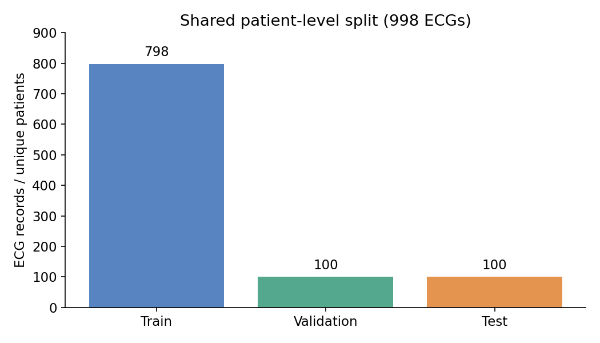
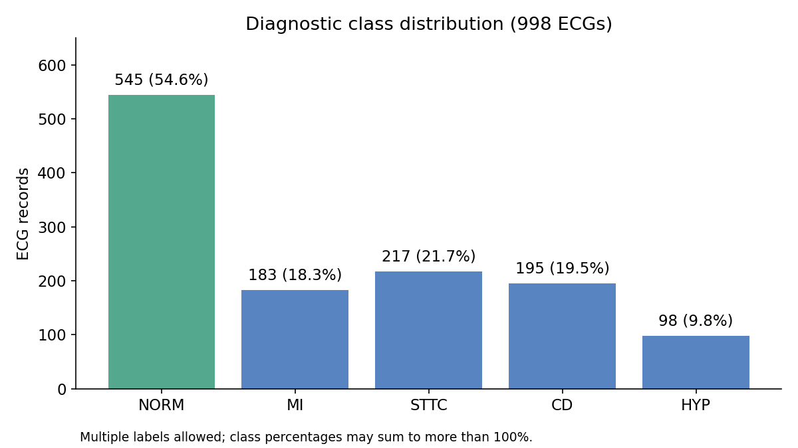
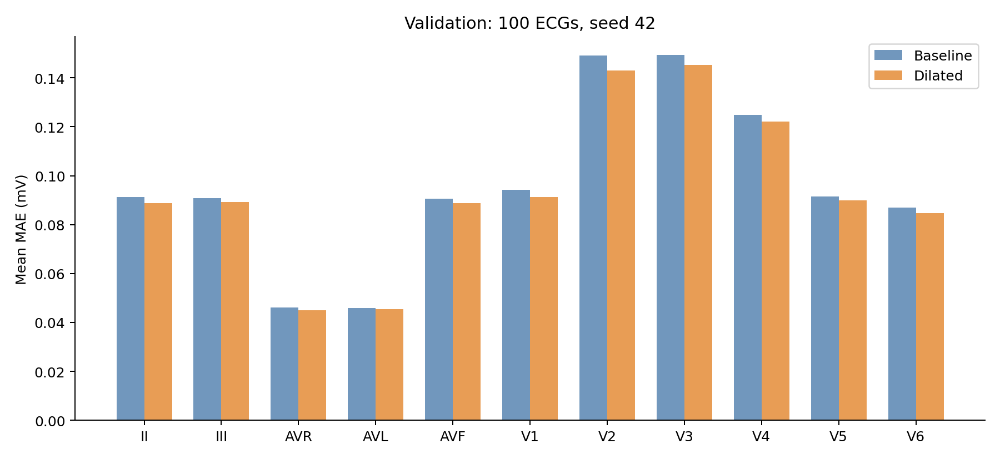
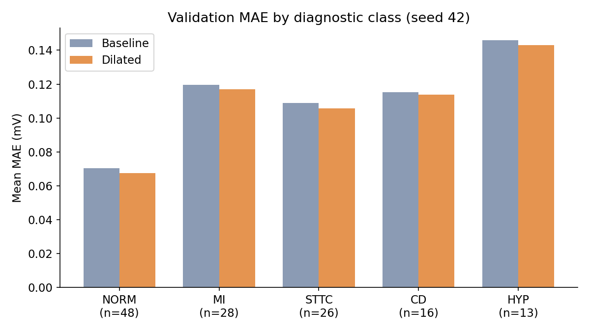
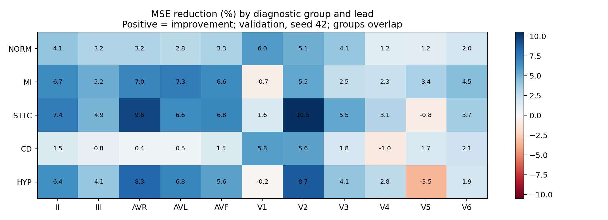
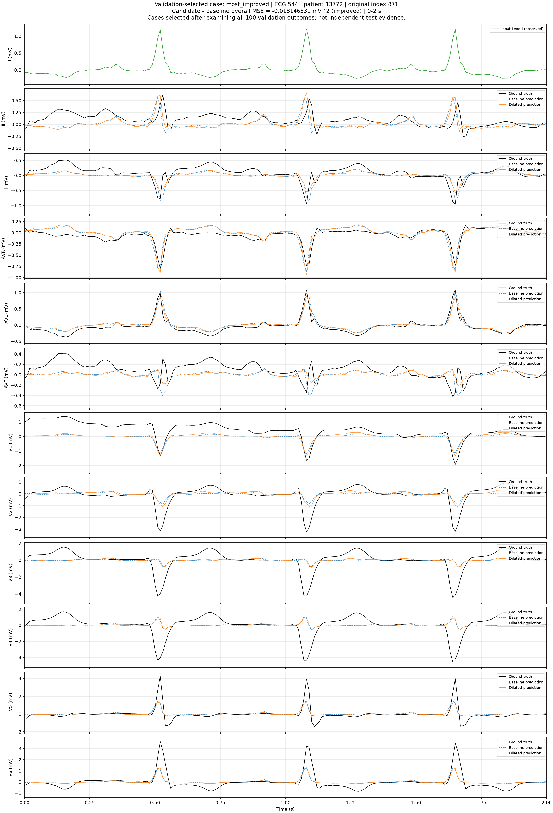
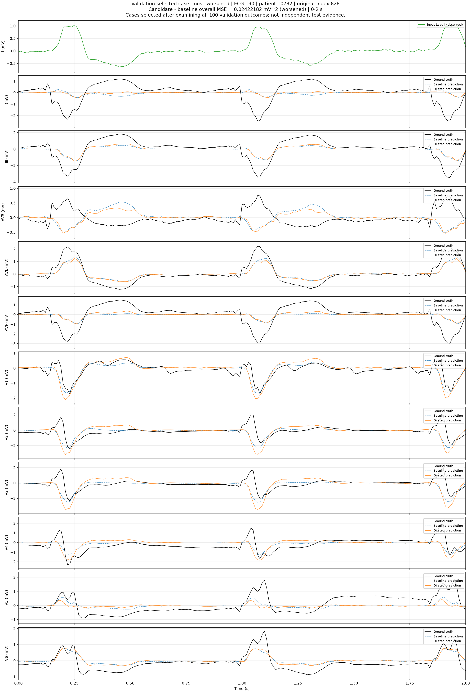

# ECG 데이터 정리 및 12유도 재구성 결과

작성일: 2026-10-31 · 담당: 2번(1번의 데이터·라벨 정리 일부 포함)

## 1. 이번에 수행한 작업

1. PTB-XL 100 Hz ECG 1,000개의 파일·환자 목록과 공식 메타데이터를 연결했다.
2. ECG ID와 환자 ID를 대조하고 진단 코드 및 5개 진단군(NORM/MI/STTC/CD/HYP)을 연결했다. 복수 진단을 유지하고 검토 대상을 별도 표시했다.
3. 기존 품질 검사에서 확인된 학습 ECG 421, 710을 제외해 최종 998개 목록을 만들었다. 기존 환자 단위 분할을 유지했다.
4. 기존에 저장된 Baseline/Dilated 모델의 seed 42 검증 100개 결과를 이용해 진단군별·유도별 오차를 집계하고 파형 사례를 분석했다.
5. 팀원에게 받은 원본 NPZ와 학습된 Dilated 체크포인트가 기존 실험 자료와 같은 SHA-256인지 확인했다.
6. 해당 모델(best epoch 28)로 998개 ECG를 CPU에서 새로 추론해 실제/재구성 12유도 배열을 저장했다. 새 모델 학습은 수행하지 않았다.
7. 배열 크기·유한값·원본 데이터 일치·라벨 연결·환자 중복·검증 오차를 확인하고 3번 분류 담당자에게 NPZ와 라벨 CSV를 전달했다.

## 2. 데이터와 공통 분할

입력은 Lead I 1개 유도이며, 모델은 나머지 11개 유도를 추정한다. 각 기록은 100 Hz, 10초(1,000시점), 전압 단위 mV이다. 재구성 12유도의 첫 채널은 관측한 Lead I이며 모델이 예측한 채널이 아니다.

| 항목 | ECG 수 | 고유 환자 수 |
|---|---:|---:|
| 학습 | 798 | 798 |
| 검증 | 100 | 100 |
| 테스트 | 100 | 100 |
| 합계 | 998 | 998 |

세 분할 사이 환자 중복은 모두 0명이다. 기존 공식 fold 기반 분할(train 1~8, validation 9, test 10)을 유지했다. 학습에서만 ECG 421과 710을 제외했다.



## 3. 라벨 연결 및 질환 분포

`ptbxl_database.csv`의 `scp_codes`를 `scp_statements.csv`의 공식 diagnostic/diagnostic_class 정의와 연결했다. 코드 존재를 기준으로 집계했고 likelihood 임계값은 적용하지 않았다. 원본 코드와 likelihood는 보존했다.

| 진단군 | 설명 | ECG 수 | 998개 대비 비율 |
|---|---|---:|---:|
| NORM | 정상 진단군 | 545 | 54.6% |
| MI | 심근경색 진단군 | 183 | 18.3% |
| STTC | ST-T 변화 진단군 | 217 | 21.7% |
| CD | 전도장애 진단군 | 195 | 19.5% |
| HYP | 비대 진단군 | 98 | 9.8% |

복수 진단이 있어 한 ECG가 여러 행의 집계에 포함될 수 있다. 비율 합계는 100%를 넘을 수 있다. NORM은 선택한 진단군 분류이며 모든 종류의 이상이 없다는 임상적 정상 확정을 의미하지 않는다.



최종 998개 라벨 상태는 NORM 진단군만 529개, 비정상 진단군 포함(NORM 없음) 445개, NORM/비정상 진단군 동시 존재 16개, 선택한 진단군 미분류 8개다. `label_status`는 탐색용 상태이며 확정된 정상/비정상 정답이 아니다. 진단 likelihood 미상 등의 검토 표시도 유지했다. 전체 1,000개 기준 검토 목록은 `tables/label_review.csv`에 있다.

## 4. 기존 모델 비교 결과 분석

아래 비교는 **seed 42의 검증 ECG 100개**에 대한 기존 저장 결과다. 테스트 성능 또는 3개 seed 평균이 아니다. 입력 Lead I을 제외한 추정 11유도를 평가한다.

| 지표 | Baseline CNN | Dilated CNN |
|---|---:|---:|
| 평균 MAE (mV) | 0.096438 | 0.093957 |
| 평균 MSE (mV²) | 0.039451 | 0.038420 |

ECG별 전체 11유도 MSE가 감소한 기록은 68/100개였다. 11개 유도 모두 평균 MAE가 감소했지만, V5의 평균 MSE는 약 0.19% 증가했다. 따라서 모든 유도와 기록에서 항상 개선됐다고 해석하지 않는다.



| 검증 진단군 | ECG 수 | Baseline MAE | Dilated MAE |
|---|---:|---:|---:|
| NORM | 48 | 0.070255 | 0.067385 |
| MI | 28 | 0.119689 | 0.116995 |
| STTC | 26 | 0.109006 | 0.105777 |
| CD | 16 | 0.115331 | 0.113664 |
| HYP | 13 | 0.145789 | 0.142952 |





진단군이 겹치고 표본 수가 적으므로 질환군 간 차이의 통계적 유의성이나 일반화를 주장하지 않는다. MAE/MSE는 기록별 지표의 그룹 평균이다. CSV의 `pooled_RMSE`는 평균 MSE의 제곱근으로, ECG별 RMSE 평균과 다르다.

## 5. 파형 사례와 한계

- ECG 544: 전체 11유도 MSE 0.399146 → 0.380998. 최대 절대 개선 사례지만 큰 피크의 높이를 충분히 복원하지 못하는 부분이 남았다. MI/STTC/HYP 진단군이 함께 기록됐다.
- ECG 190: MSE 0.361829 → 0.386057. 악화 사례이며 선택한 5개 진단군으로 분류되지 않는다. 임의로 정상으로 처리하지 않는다.
- ECG 155: MSE 0.009488 → 0.008792. 기존 중앙값 근처 사례다. 상세 지표는 `tables/case_metrics.csv`를 참고한다.

다음 그림은 기존 검증 파형의 0~2초 확대본이며 수치 지표는 10초 전체 기준이다. 검정=실제, 파란 점선=Baseline, 주황=Dilated. 사례는 결과를 본 뒤 선택한 예시이며 질환군의 대표 표본이 아니다.





## 6. 새로 생성한 분류용 재구성 데이터

`ecg_for_classification.npz`를 3번에게 별도로 전달했다. 해당 대용량 배열과 가중치는 이 보고서 폴더에 포함하지 않는다.

| NPZ 키 | 크기/내용 |
|---|---|
| `lead_i` | (998, 1000, 1), 관측 Lead I |
| `actual_12lead` | (998, 1000, 12), 실제 12유도 |
| `reconstructed_12lead` | (998, 1000, 12), 관측 Lead I + 추정 11유도 |
| `ecg_id`, `patient_id` | 각 (998,), 기록·환자 식별자 |
| `split` | train / validation / test |
| `lead_names` | I, II, III, AVR, AVL, AVF, V1~V6 |
| `sampling_rate_hz`, `voltage_unit` | 100, mV |

모델: 기존 Dilated CNN(seed 42, best epoch 28). CPU, batch size 16, 추가 정규화나 필터링 없이 원본 NPZ의 입력으로 추론했다. 새 추론의 검증 11유도 MAE=0.09395703, MSE=0.03842027로 기존 결과와 일치했다.

배열은 모두 유한값이며 입력 Lead I은 실제/재구성 배열의 첫 채널과 정확히 같다. 원본 NPZ의 ECG ID·환자 ID·분할 및 실제 신호와 일치하고 라벨 CSV도 ID로 대조했다. 해시와 검증 정보는 `verification.json`에 기록했다.

## 7. 3번에게 전달한 자료와 사용 기준

1. `ecg_for_classification.npz`: 입력·실제·재구성 ECG와 공통 분할.
2. `tables/ecg_labels_analysis_998.csv`: 같은 기록의 진단 코드·진단군·검토 표시.

`ecg_id`로 일대일 연결하고 기존 `split`을 유지한다. CSV의 NORM/MI/STTC/CD/HYP는 복수 라벨을 허용한다. 미분류·NORM과 비정상 동시 존재·likelihood 미상 기록의 처리, 최종 분류 목표와 라벨 규칙은 1번/3번과 확정해야 한다. 검토가 필요한 기록을 임의로 정상 처리하지 않는다.

후속 분류에서는 Lead I / 실제 12유도 / 재구성 12유도를 같은 환자와 분할로 비교한다. 분류 모델 및 전처리는 학습 자료로 학습하고 검증 자료로 설정한 뒤 테스트는 최종 평가에 사용한다. 현재 재구성 오차 분석만으로 질환 특징 보존이나 분류 성능 개선이 입증된 것은 아니다.

## 8. 포함 파일 및 재현

- `tables/`: 라벨 목록, 진단 코드 상세, 검토 목록, 분포표, 공통 분할, 진단군·유도별 오차, 사례 지표.
- `figures/`: 위 그래프와 기존 파형 비교 그림.
- `verification.json`: 원본/체크포인트/생성 NPZ SHA-256 및 데이터 검증 결과.
- `scripts/export_classification.py`: 기존 프로젝트의 검증 로더를 이용한 재구성 배열 생성 스크립트.

원래 프로젝트의 `ecg_reconstruction` 폴더에서 다음과 같이 실행한다. 원본 NPZ와 체크포인트는 별도로 필요하며 기존 모델 소스 파일은 수정하지 않는다.

```powershell
.\.venv\Scripts\python.exe .\reports\role2_summary_20261031\scripts\export_classification.py --checkpoint .\best_model.pth --dataset .\ptbxl_100hz_1000records.npz --output .\results\classification_export
```

이 보고서는 기존 실험의 저장 결과 재분석과 새 추론·인계 작업을 정리한 것이다. 기존 모델 학습과 기존 파형 그래프는 팀원의 원래 실험 결과를 재사용했다. 이번에 질환 분포·분할·진단군 비교 그래프를 추가 제작했다. 새 테스트 성능 평가와 후속 질환 분류 학습은 이 작업 범위에 포함하지 않았다.
